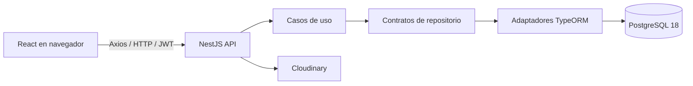

# ZeroInventory

Aplicación web para administrar productos e inventario y permitir a clientes comprar desde un catálogo. Incluye tienda, carrito, direcciones, pedidos, pagos registrados, proveedores, empleados, usuarios, panel administrativo y contenido multimedia.

El trabajo siguiente se organiza por etapas en [docs/plan-de-trabajo.md](docs/plan-de-trabajo.md). Está activa la revisión funcional de la etapa 1; su evidencia y pendientes están en [docs/revision-funcional-mvp.md](docs/revision-funcional-mvp.md). Las vistas de usuarios y reportes avanzados todavía son provisionales. El alcance completo del MVP requiere aceptación del responsable del proyecto.

## Requisitos

- Windows con PowerShell, o un sistema con Node.js y Docker equivalentes.
- Node.js **22.12 o superior**. Esta revisión se validó localmente con Node **24.11.0**.
- pnpm **10**; versión utilizada: **10.33.2**.
- Docker Desktop iniciado, con el motor de contenedores Linux disponible.
- Git y acceso al repositorio para publicar ramas.
- Credenciales de Cloudinary para cargar imágenes o videos. Las pruebas de inventario no necesitan subir archivos externos.

No existe un servicio Node adicional ni se necesita una tercera consola para desarrollar. Docker mantiene la base de datos en segundo plano; backend y frontend se ejecutan en dos consolas.

## Arranque con dos consolas

Abre ambas consolas en la raíz de este repositorio. Si clonaste una copia nueva, conserva los nombres de las carpetas `backend` y `frontend`.

### Consola 1: backend y base de datos

```powershell
cd backend
pnpm install --frozen-lockfile
pnpm setup:env
docker compose -f ..\docker-compose.yml up -d db
pnpm start:dev
```

`setup:env` crea el archivo raíz `.env` si no existe y genera secretos locales. Conserva las credenciales existentes de PostgreSQL. Si encuentra secretos JWT demasiado cortos en `backend/.env`, los reemplaza; las sesiones anteriores necesitarán iniciar sesión otra vez.

`start:dev` aplica las migraciones pendientes **antes** de iniciar Nest en modo observación. Si una migración falla, el servidor no arranca con un esquema incompleto. No ejecuta sincronización automática ni borra tablas para resolver errores.

Si las dependencias y el entorno ya están preparados, basta con los dos últimos comandos de esta consola. Si la DB ya está activa, el comando Docker comprueba o actualiza ese servicio sin eliminar su volumen.

### Consola 2: frontend

```powershell
cd frontend
pnpm install --frozen-lockfile
pnpm dev
```

Vite muestra la URL del frontend, normalmente `http://localhost:5173`. El frontend utiliza `http://localhost:3000` como API por defecto. Para cambiarla, crea `frontend/.env.local` con `VITE_API_URL`; `frontend/.env.example` contiene un ejemplo.

### Direcciones locales

| Servicio | Dirección |
| --- | --- |
| Frontend | http://localhost:5173 |
| API | http://localhost:3000 |
| Swagger | http://localhost:3000/api/docs |
| PostgreSQL desde Windows | localhost:5432 |
| pgAdmin opcional | http://localhost:8082 |

Para iniciar pgAdmin, desde `backend` ejecuta `docker compose -f ..\docker-compose.yml up -d pgAdmin`. `setup:env` prepara sus variables en el `.env` raíz. Un volumen de pgAdmin existente conserva la contraseña que ya tenía: cambiar la variable no cambia esa cuenta almacenada.

En esta revisión se actualizaron explícitamente las contraseñas locales de PostgreSQL y pgAdmin, con respaldo y comprobación de acceso. Sus valores actuales están en `DB_PASSWORD` y `PGADMIN_DEFAULT_PASSWORD` del `.env` raíz; no se publican en Git. Si un servidor registrado en pgAdmin conserva la antigua contraseña de PostgreSQL, vuelve a ingresar el valor actual de `DB_PASSWORD` al conectarlo.

Para detener Node usa `Ctrl+C` en su consola. Para detener la DB conservando los datos: `docker compose -f ..\docker-compose.yml stop db`. **No uses `down -v`**, porque elimina los volúmenes con datos.

## Contenedor de este proyecto

El servicio de PostgreSQL es `db`, su contenedor es **`postgres-zero-inventory`**, la imagen es `postgres:18.0` y el proyecto Compose es `zeroinventory`. El volumen es `postgres_data` dentro de ese proyecto. El montaje `/var/lib/postgresql` corresponde a PostgreSQL 18.

El 12 de noviembre de 2026 se comprobó que ese contenedor estaba activo y publicado en `5432`. `forestguard-db-1`, `postgres-ordergo` y `database-postgres` pertenecen a otros proyectos. No deben activarse para ZeroInventory ni eliminarse al mantener este repositorio.

```powershell
docker compose -f ..\docker-compose.yml ps
docker ps --format "table {{.Names}}\t{{.Image}}\t{{.Ports}}"
docker logs --tail 50 postgres-zero-inventory
```

Desde pgAdmin, registra el servidor con host **`db`**, puerto `5432` y los valores `DB_USER`, `DB_PASSWORD`, `DB_NAME` del `.env` raíz. Desde una aplicación ejecutada en Windows el host es `localhost`.

## Configuración

Nest y los comandos de base de datos comparten la configuración. Las variables del proceso tienen precedencia; a continuación se carga `backend/.env` y finalmente el `.env` raíz. Revisa ambos archivos si observas un comportamiento inesperado. Docker Compose utiliza el `.env` raíz.

| Variable | Uso |
| --- | --- |
| `NODE_ENV` | `development`, `test` o `production` |
| `PORT` | Puerto de Nest, por defecto 3000 |
| `DB_HOST`, `DB_PORT`, `DB_USER`, `DB_PASSWORD`, `DB_NAME` | Conexión PostgreSQL local |
| `DATABASE_URL` | Alternativa a los campos de conexión anteriores |
| `DB_SSL` | Activa TLS; por defecto se exige en producción |
| `DB_SSL_CA` | CA del proveedor, con `\n` escapados si hace falta; se verifica el certificado |
| `JWT_ACCESS_SECRET`, `JWT_REFRESH_SECRET` | Secretos diferentes, de al menos 32 caracteres |
| `JWT_ACCESS_EXPIRES_IN`, `JWT_REFRESH_EXPIRES_IN` | Expiración, por defecto `15m` y `7d` |
| `CORS_ORIGINS` | Orígenes separados por coma, sin rutas; obligatorio en producción |
| `COOKIE_SECURE`, `COOKIE_SAME_SITE` | Configuración de la cookie de renovación; producción exige HTTPS |
| `PGADMIN_DEFAULT_EMAIL`, `PGADMIN_DEFAULT_PASSWORD` | Inicialización de pgAdmin |
| `CLOUDINARY_NAME`, `CLOUDINARY_KEY`, `CLOUDINARY_SECRET` | Almacenamiento de medios |
| `VITE_API_URL` | Variable pública del frontend; nunca incluir secretos bajo `VITE_` |

`JWT_SECRET` y `JWT_EXPIRES_IN`, presentes en configuraciones antiguas, no son las variables usadas por el sistema actual. No publiques archivos `.env`, respaldos, tokens ni volcados. `.gitignore` los excluye.

En producción configura orígenes HTTPS y `COOKIE_SECURE=true`. Si frontend y API están en sitios diferentes, `COOKIE_SAME_SITE=none` requiere una cookie segura. Usa una CA válida para PostgreSQL; el código no desactiva la verificación del certificado.

## Arquitectura y tecnologías

ZeroInventory es un **monolito modular** con una SPA y una API REST. Cada proceso tiene su propio `package.json`, lockfile y dependencias. No se debe ejecutar `pnpm install` en la raíz.



| Área | Tecnología y responsabilidad |
| --- | --- |
| Frontend | React 19, TypeScript 6, Vite 8 y React Compiler |
| Navegación | React Router 7; protección visual de rutas por rol |
| Datos remotos | TanStack Query 5 para consultas, caché e invalidaciones; Axios para HTTP |
| Estado local | Zustand 5 para sesión, preferencias y estado de interfaz |
| Formularios | React Hook Form, Zod y sus resolvers |
| Interfaz | Tailwind CSS 4, Radix UI, Lucide, Framer Motion, Sonner y Recharts |
| Backend | NestJS 11, TypeScript 5, plataforma Express, inyección de dependencias |
| Persistencia | TypeORM 0.3 y driver `pg` |
| Autenticación | Passport JWT, bcrypt, cookie HttpOnly de renovación |
| Contratos HTTP | DTOs, class-validator, class-transformer y Swagger |
| Medios | Multer y Cloudinary |
| Calidad | TypeScript, ESLint, Jest, ts-jest y Supertest |

### Organización

```text
backend/
  config/                 entorno, HTTP, base de datos y Swagger
  infrastructure/         conexión y servicios externos compartidos
  src/<modulo>/
    domain/               entidades y contratos
    application/          casos de uso y DTOs
    adapters/             controladores, guards y documentación HTTP
    infrastructure/       ORM, mappers e implementaciones
  src/migrations/         evolución explícita del esquema
  scripts/                entorno, migración, diagnóstico y pruebas aisladas
  test/                   integración HTTP y PostgreSQL
frontend/src/
  modules/<feature>/      funcionalidad organizada por dominio/aplicación/infraestructura/presentación
  pages/                  pantallas y composición de rutas existentes
  infrastructure/http/    Axios y renovación de sesión
  shared/                 componentes, layouts, UI, hooks y utilidades
  core/                   entorno y tema
docs/                     modelo de datos y diagnóstico de esta revisión
```

La arquitectura sigue principios de Clean Architecture: los casos de uso coordinan el negocio y los repositorios aíslan la persistencia. Hay módulos históricos con nombres de carpetas distintos y casos de uso de consultas/checkout que acceden directamente a TypeORM. Consulta `AGENTS.md` para aplicar la separación sin introducir otra estructura incompatible.

Los directorios históricos `kardex`, `ajuste-inventario` y `compra-detalle` se conservaron al integrar `dev`. Sus entidades ORM son canónicas y se registran una sola vez. Sus módulos CRUD históricos **no** se importan en `AppModule`: los movimientos y ajustes activos pasan por `InventoryModule` para respetar las transacciones. No habilites esos CRUD sin adaptar sus escrituras y permisos.

## Roles y autenticación

- `ADMIN`: gestión administrativa, usuarios, empleados, reportes y contenido.
- `EMPLOYEE`: productos, proveedores, inventario y sus ajustes; las rutas con roles explícitos pueden restringir más.
- `CUSTOMER`: carrito, pedidos y direcciones propios, configuración de su cuenta y catálogo.
- Público: login, registro, renovación de sesión, logout y lecturas de catálogo/medios marcadas con `@Public()`.

El guard global exige autenticación en las rutas que no son públicas. Si una ruta no declara roles, admite por defecto `ADMIN` y `EMPLOYEE`. Roles y asignaciones de roles requieren `ADMIN`. La UI no sustituye los permisos del backend. Las direcciones de clientes validan propiedad antes de consultar, editar o eliminar.

El access token permanece en memoria en Zustand y se envía como Bearer. El refresh token viaja en una cookie HttpOnly, limitada a `/auth/refresh`; Axios coordina una única renovación concurrente y reintenta una vez la solicitud. Logout elimina la cookie. No existe una lista de revocación de tokens: un access token emitido conserva su validez hasta expirar.

Una instalación nueva crea los tres roles mediante migración. El registro público crea clientes. Para preparar el primer administrador se incluye `pnpm admin:create`; solicita usuario y contraseña por variables de proceso, sin credenciales predeterminadas. Consulta su descripción más abajo.

## Inventario y pedidos

`producto.cantidad` es el saldo materializado que consume el catálogo. Debe coincidir con **entradas menos salidas del Kardex**. Un ajuste registra un documento de auditoría en `ajuste_inventario` y una entrada o salida de tipo de referencia `AJUSTE`. No se suma el documento de auditoría otra vez al calcular el saldo.

La creación de producto guarda SKU definitivo y saldo inicial en una transacción. Los cambios manuales de cantidad bloquean el producto, verifican el saldo esperado y guardan producto, auditoría y movimiento juntos. Las reducciones también crean una salida. Un fallo no se oculta con `console.error`: revierte la operación.

El checkout verifica cliente y dirección activa, bloquea el carrito y los productos, vuelve a leer cantidades y precios y calcula el total en centavos. Luego guarda pedido, detalles, pago pendiente y movimientos; descuenta stock y retira las líneas compradas. Todo ocurre en una transacción. Los bloqueos de productos tienen un orden estable; un bloqueo por cliente serializa la numeración de sus pedidos. La DB también exige números únicos por cliente y cantidades válidas.

Los importes usan `numeric(14,2)`: el antiguo `numeric(10,2)` producía errores al superar cien millones. Los cálculos críticos de checkout usan centavos y validan el rango. Los pagos de este repositorio son registros y estados internos; no hay una integración de cobro bancario automático.

## Base de datos y migraciones

El modelo contiene 21 tablas de negocio y la tabla técnica `migrations`. El diccionario completo de columnas y claves está en [docs/database-schema.md](docs/database-schema.md).

```powershell
# Desde backend
pnpm db:status
pnpm db:migrate
pnpm db:check
pnpm db:docs
```

- `InitialSchema1794441600000`: crea una instalación vacía o adopta una existente con las tablas esperadas; no elimina datos existentes.
- `HardenInventory1794441601000`: amplía importes, preserva los números históricos al reconciliar números cero/duplicados, agrega integridad de stock, concilia el Kardex mediante movimientos compensatorios y asegura los roles iniciales.
- `numero_pedido_usuario_legacy` conserva el número anterior de un pedido renumerado. El ID primario `pedido_id` no cambia y sus relaciones se mantienen.
- La conciliación conserva la cantidad del producto y los movimientos anteriores; agrega la diferencia necesaria al Kardex. Es una adopción del saldo existente, no una certificación de sus costos contables históricos.
- La migración antigua `1779230015497-UpdateAjusteInventarioTipoMovimiento.ts` se conserva como historial, pero su corrección está incorporada al conjunto actual; no se ejecuta adicionalmente.
- `synchronize` permanece desactivado en todos los entornos. Las migraciones se ejecutan dentro de una transacción y el comando toma un bloqueo para evitar dos migraciones simultáneas.

El retorno automático de estas migraciones se rechaza porque una reversión destructiva perdería trazabilidad. Para volver a un estado anterior, detén la API y restaura un respaldo revisado en una base separada.

## Respaldo y recuperación

Antes de modificar un esquema con datos, genera un respaldo. Desde la raíz, en PowerShell:

```powershell
New-Item -ItemType Directory -Force .local/backups
docker exec postgres-zero-inventory sh -c 'pg_dump -U "$POSTGRES_USER" -d "$POSTGRES_DB" -Fc -f /tmp/zero-inventory.dump'
docker cp postgres-zero-inventory:/tmp/zero-inventory.dump .local/backups/zero-inventory.dump
```

Para una recuperación, crea una base nueva con otro nombre y usa `pg_restore` sobre esa base. No restaures encima de la DB activa sin una revisión del destino. Cambia después `DB_NAME` para inspeccionar la copia con la aplicación detenida. Guarda las copias fuera del repositorio si son importantes: `.local/` no se publica.

El respaldo anterior a esta revisión está localmente en `.local/backups/zero-inventory-before-fixes.dump`. Las pruebas de actualización generan además una copia temporal de la base y verifican conservación de filas e idempotencia.

## Validaciones y pruebas

Detén el proceso en observación si vas a realizar una validación completa, y ejecuta estos comandos en las mismas dos consolas.

```powershell
# Consola backend
pnpm typecheck
pnpm lint
pnpm test --runInBand
pnpm test:integration
pnpm test:upgrade
pnpm build
pnpm db:check
```

```powershell
# Consola frontend
pnpm typecheck
pnpm lint
pnpm build
```

`test:integration` crea una DB con prefijo `zero_inventory_test_`, ejecuta la API y sus pruebas y elimina únicamente esa DB temporal. Requiere permiso `CREATEDB` del usuario local. No crea clientes de prueba en la DB habitual. Cubre concurrencia, numeración, saldos, reversión, importes grandes, permisos, direcciones, cookies y CORS.

`test:upgrade` requiere Docker y el contenedor de este proyecto. Copia la DB real a una base temporal, aplica migraciones allí y verifica que ninguna tabla pierda filas, que los saldos coincidan y que repetir las migraciones no haga cambios. Nunca limpia ni reemplaza la DB original.

El script histórico `smoke-customer-cart-checkout.mjs` ya no es el procedimiento de prueba recomendado: asume endpoints de preparación abiertos. Usa la suite aislada.

ESLint del frontend revisa `.ts` y `.tsx`, además de JavaScript. `frontend build` incluye el chequeo de tipos. Los avisos de código histórico se distinguen de los errores; consulta [docs/validation.md](docs/validation.md) para los resultados de esta revisión.

## Comandos adicionales

| Directorio | Comando | Propósito |
| --- | --- | --- |
| backend | `pnpm start:dev` | Migra e inicia API con observación |
| backend | `pnpm build` | Compila a `dist` |
| backend | `pnpm start:prod` | Ejecuta el backend compilado; migrar antes |
| backend | `pnpm lint:fix` | Correcciones automáticas de ESLint; revisar diff |
| backend | `pnpm format` | Prettier; revisar el alcance del formateo |
| backend | `pnpm admin:create` | Crea un administrador local con credenciales suministradas |
| frontend | `pnpm dev` | Vite con recarga |
| frontend | `pnpm build` | Verifica tipos y crea artefactos estáticos |
| frontend | `pnpm preview` | Inspecciona el build local; no es hosting de producción |

Para crear un administrador desde PowerShell, define `$env:ADMIN_USERNAME` y `$env:ADMIN_PASSWORD`, ejecuta `pnpm admin:create` y elimina esas variables con `Remove-Item Env:ADMIN_USERNAME, Env:ADMIN_PASSWORD` al terminar. La contraseña debe tener al menos 12 caracteres. El script no imprime la contraseña y no reemplaza usuarios existentes.

## Git y el rechazo de push

El repositorio utiliza `dev` para integración. En esta revisión se reprodujo `non-fast-forward` al intentar subir la antigua `feature/products` directamente a `dev`: ambas ramas tenían commits que la otra no contenía. La solución es integrar las dos historias y resolver sus conflictos antes de publicar, sin forzar el push.

Los errores de PostgreSQL al arrancar eran independientes de Git. No existe un hook del repositorio que exija eliminar filas o tablas para hacer push. Se encontraron fallos de `ALTER TABLE ... ADD ... NOT NULL` sobre tablas con registros, errores de claves foráneas y desbordamientos monetarios. El detalle está en [docs/diagnostics.md](docs/diagnostics.md).

```powershell
git status
git fetch origin
git switch dev
git pull --ff-only origin dev
git switch -c codex/descripcion-del-cambio
# Implementar, probar y revisar git diff
git add <archivos-revisados>
git commit -m "fix: descripcion concreta"
git push -u origin codex/descripcion-del-cambio
```

Integra a `dev` mediante el flujo acordado del repositorio. Si aparece otro rechazo, vuelve a consultar el remoto y conserva ambos historiales. No uses `git push --force`, `git reset --hard` ni elimines la DB para resolver un problema de versionado.

## Despliegue

Compose administra los servicios de datos locales. El backend y frontend continúan siendo procesos independientes. En producción: prepara los secretos, verifica el certificado PostgreSQL, respalda, aplica `pnpm db:migrate`, compila el backend y ejecútalo con `pnpm start:prod`. Publica `frontend/dist` en un servidor con fallback de rutas a `index.html` y configura `VITE_API_URL` antes de compilar. Expón la API por HTTPS y ajusta CORS al origen real.

No se configura automáticamente un proveedor de hosting, un dominio, ni un procesador de pagos. Swagger se publica en `/api/docs`; decide su accesibilidad en el proxy del entorno de despliegue.
