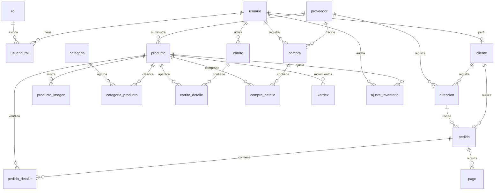

# Modelo de datos de ZeroInventory

Diccionario generado desde las entidades ORM canónicas. Incluye el estado esperado después de aplicar las migraciones; no contiene registros ni credenciales.

Hay 21 tablas de negocio y la tabla técnica `migrations`. Todas usan claves primarias numéricas generadas. Las relaciones que se muestran abajo son claves foráneas declaradas en TypeORM. `empleado.usuario_id` es una referencia lógica opcional que actualmente no tiene una FK declarada.

## Reglas adicionales de las migraciones

- Pedido: índice único `uq_pedido_cliente_numero` sobre `(cliente_id, numero_pedido_usuario)`. Los números anteriores conciliados quedan en `numero_pedido_usuario_legacy`.
- Producto: `cantidad >= 0`; líneas de carrito y pedido y movimientos de Kardex: `cantidad > 0`.
- Importes de producto, compra, pedido, detalles, pago y Kardex: `numeric(14,2)`.
- El saldo materializado de producto debe coincidir con entradas menos salidas del Kardex. Los ajustes se documentan por separado y sus efectos se reflejan en movimientos firmados por dirección.
- No hay eliminaciones en cascada del historial de ventas o inventario. Los maestros con estado se desactivan; las restricciones de otras relaciones se responden como HTTP 409.

## Relaciones principales

El contenido multimedia (`media`) es independiente. La relación empleado–usuario es lógica y no se representa como FK en el diagrama.

## ajuste_inventario

| Columna | Tipo | NULL | Observación |
| --- | --- | --- | --- |
| `ajuste_inventario_id` | Number | No | PK generada |
| `producto_id` | Number | No | FK → producto(producto_id) |
| `usuario_id` | Number | No | FK → usuario(usuario_id) |
| `tipo_movimiento` | enum: ENTRADA, SALIDA, AJUSTE | Sí |  |
| `cantidad` | int | No |  |
| `stock_anterior` | int | Sí |  |
| `stock_nuevo` | int | Sí |  |
| `tipo_cambio` | enum: AUMENTO, REDUCCION | Sí |  |
| `motivo` | text | No |  |
| `fecha` | timestamp | No |  |

## carrito

| Columna | Tipo | NULL | Observación |
| --- | --- | --- | --- |
| `carrito_id` | Number | No | PK generada |
| `usuario_id` | Number | No | FK → usuario(usuario_id) |
| `estado` | enum: ABIERTO, CERRADO | No |  |
| `created_at` | timestamp | No |  |
| `updated_at` | timestamp | No |  |

## carrito_detalle

| Columna | Tipo | NULL | Observación |
| --- | --- | --- | --- |
| `carrito_detalle_id` | Number | No | PK generada |
| `carrito_id` | Number | No | FK → carrito(carrito_id) |
| `producto_id` | Number | No | FK → producto(producto_id) |
| `cantidad` | int | No |  |
| `created_at` | timestamp | No |  |
| `updated_at` | timestamp | No |  |

## categoria

| Columna | Tipo | NULL | Observación |
| --- | --- | --- | --- |
| `categoria_id` | Number | No | PK generada |
| `nombre` | varchar | No | UNIQUE |
| `created_at` | timestamp | No |  |
| `updated_at` | timestamp | No |  |

## categoria_producto

| Columna | Tipo | NULL | Observación |
| --- | --- | --- | --- |
| `categoria_producto_id` | Number | No | PK generada |
| `categoria_id` | Number | No | FK → categoria(categoria_id) |
| `producto_id` | Number | No | FK → producto(producto_id) |
| `created_at` | timestamp | No |  |
| `updated_at` | timestamp | No |  |

## cliente

| Columna | Tipo | NULL | Observación |
| --- | --- | --- | --- |
| `cliente_id` | Number | No | PK generada |
| `usuario_id` | Number | No | FK → usuario(usuario_id); UNIQUE |
| `tipo_documento` | enum: CC, CE, PASAPORTE | Sí |  |
| `documento` | varchar | No | UNIQUE |
| `created_at` | timestamp | No |  |
| `updated_at` | timestamp | No |  |

## compra

| Columna | Tipo | NULL | Observación |
| --- | --- | --- | --- |
| `compra_id` | Number | No | PK generada |
| `proveedor_id` | Number | No | FK → proveedor(proveedor_id) |
| `usuario_id` | Number | No | FK → usuario(usuario_id) |
| `total` | numeric(14,2) | No |  |
| `fecha_compra` | timestamp | No |  |

## compra_detalle

| Columna | Tipo | NULL | Observación |
| --- | --- | --- | --- |
| `compra_detalle_id` | Number | No | PK generada |
| `compra_id` | Number | No | FK → compra(compra_id) |
| `producto_id` | Number | No | FK → producto(producto_id) |
| `cantidad` | int | No |  |
| `costo_unitario` | numeric(14,2) | No |  |
| `subtotal` | numeric(14,2) | No |  |

## direccion

| Columna | Tipo | NULL | Observación |
| --- | --- | --- | --- |
| `direccion_id` | Number | No | PK generada |
| `cliente_id` | Number | Sí | FK → cliente(cliente_id) |
| `proveedor_id` | Number | Sí | FK → proveedor(proveedor_id) |
| `linea_dir` | varchar | No |  |
| `barrio` | varchar | No |  |
| `codigo_postal` | varchar(8) | Sí |  |
| `info_adiccional` | text | Sí |  |
| `es_predeterminada` | boolean | No |  |
| `estado` | boolean | No |  |

## empleado

| Columna | Tipo | NULL | Observación |
| --- | --- | --- | --- |
| `empleado_id` | Number | No | PK generada |
| `nombre` | varchar(255) | No |  |
| `email` | varchar(255) | No | UNIQUE |
| `estado` | varchar(20) | No |  |
| `usuario_id` | int | Sí |  |
| `telefono` | varchar(20) | Sí |  |
| `documento` | varchar(50) | Sí | UNIQUE |
| `created_at` | timestamp | No |  |
| `updated_at` | timestamp | No |  |

## kardex

| Columna | Tipo | NULL | Observación |
| --- | --- | --- | --- |
| `kardex_id` | Number | No | PK generada |
| `producto_id` | Number | No | FK → producto(producto_id) |
| `tipo_movimiento` | enum: ENTRADA, SALIDA, AJUSTE | No |  |
| `cantidad` | int | No |  |
| `costo_unitario` | numeric(14,2) | No |  |
| `valor_total` | numeric(14,2) | No |  |
| `referencia_id` | int | No |  |
| `tipo_referencia` | enum: COMPRA, VENTA, AJUSTE | No |  |
| `fecha_movimiento` | timestamp | No |  |

## media

| Columna | Tipo | NULL | Observación |
| --- | --- | --- | --- |
| `mediaId` | Number | No | PK generada |
| `tipo` | varchar(50) | No |  |
| `titulo` | varchar(150) | No |  |
| `descripcion` | text | Sí |  |
| `url` | text | No |  |
| `publicId` | varchar(255) | No |  |
| `estado` | varchar(20) | No |  |
| `orden` | int | No |  |
| `createdAt` | timestamp | No |  |
| `updatedAt` | timestamp | No |  |

## pago

| Columna | Tipo | NULL | Observación |
| --- | --- | --- | --- |
| `pago_id` | Number | No | PK generada |
| `pedido_id` | Number | No | FK → pedido(pedido_id) |
| `metodo_pago` | enum: EFECTIVO, TRANSFERENCIA | No |  |
| `monto` | numeric(14,2) | No |  |
| `estado` | enum: PENDIENTE, APROBADO, RECHAZADO | No |  |
| `fecha_pago` | timestamp | No |  |

## pedido

| Columna | Tipo | NULL | Observación |
| --- | --- | --- | --- |
| `pedido_id` | Number | No | PK generada |
| `cliente_id` | Number | No | FK → cliente(cliente_id) |
| `direccion_id` | Number | No | FK → direccion(direccion_id) |
| `estado` | enum: COMPLETADO, CONFIRMADO, ENVIADO, CANCELADO, DEVUELTO | No |  |
| `total` | numeric(14,2) | No |  |
| `numero_pedido_usuario` | int | No |  |
| `numero_pedido_usuario_legacy` | int | Sí |  |
| `fecha` | timestamp | No |  |

## pedido_detalle

| Columna | Tipo | NULL | Observación |
| --- | --- | --- | --- |
| `pedido_detalle_id` | Number | No | PK generada |
| `pedido_id` | Number | No | FK → pedido(pedido_id) |
| `producto_id` | Number | No | FK → producto(producto_id) |
| `cantidad` | int | No |  |
| `precio_unitario` | numeric(14,2) | No |  |
| `subtotal` | numeric(14,2) | No |  |

## producto

| Columna | Tipo | NULL | Observación |
| --- | --- | --- | --- |
| `producto_id` | Number | No | PK generada |
| `proveedor_id` | Number | Sí | FK → proveedor(proveedor_id) |
| `nombre` | varchar | No |  |
| `cantidad` | int | No |  |
| `precio` | numeric(14,2) | No |  |
| `descripcion` | text | Sí |  |
| `sku` | varchar | No | UNIQUE |
| `marca` | varchar | Sí |  |
| `material` | varchar | Sí |  |
| `peso` | varchar | Sí |  |
| `medida` | varchar | Sí |  |
| `is_active` | boolean | No |  |
| `created_at` | timestamp | No |  |
| `updated_at` | timestamp | No |  |

## producto_imagen

| Columna | Tipo | NULL | Observación |
| --- | --- | --- | --- |
| `imagen_producto_id` | Number | No | PK generada |
| `producto_id` | Number | No | FK → producto(producto_id) |
| `url` | varchar | No |  |
| `public_id` | varchar | No |  |
| `created_at` | timestamp | No |  |
| `updated_at` | timestamp | No |  |

## proveedor

| Columna | Tipo | NULL | Observación |
| --- | --- | --- | --- |
| `proveedor_id` | Number | No | PK generada |
| `nombre` | varchar | No |  |
| `nombre_titular` | varchar | Sí |  |
| `telefono` | varchar | Sí |  |
| `email` | varchar | Sí |  |
| `is_active` | boolean | No |  |

## rol

| Columna | Tipo | NULL | Observación |
| --- | --- | --- | --- |
| `rol_id` | Number | No | PK generada |
| `nombre` | enum: ADMIN, EMPLOYEE, CUSTOMER | No |  |

## usuario

| Columna | Tipo | NULL | Observación |
| --- | --- | --- | --- |
| `usuario_id` | Number | No | PK generada |
| `username` | varchar | No | UNIQUE |
| `email` | varchar | Sí | UNIQUE |
| `telefono` | varchar(20) | Sí |  |
| `password` | varchar | No |  |
| `primer_nombre` | varchar | Sí |  |
| `segundo_nombre` | varchar | Sí |  |
| `primer_apellido` | varchar | Sí |  |
| `segundo_apellido` | varchar | Sí |  |
| `theme` | varchar(20) | No |  |
| `is_active` | boolean | No |  |
| `created_at` | timestamp | No |  |
| `updated_at` | timestamp | No |  |

## usuario_rol

| Columna | Tipo | NULL | Observación |
| --- | --- | --- | --- |
| `usuario_rol_id` | Number | No | PK generada |
| `usuario_id` | Number | No | FK → usuario(usuario_id) |
| `rol_id` | Number | No | FK → rol(rol_id) |

## Mantenimiento

Regenerar desde `backend` con `pnpm db:docs` después de cambiar entidades y migraciones. `synchronize` permanece desactivado; este comando solo lee metadatos y escribe este documento.
